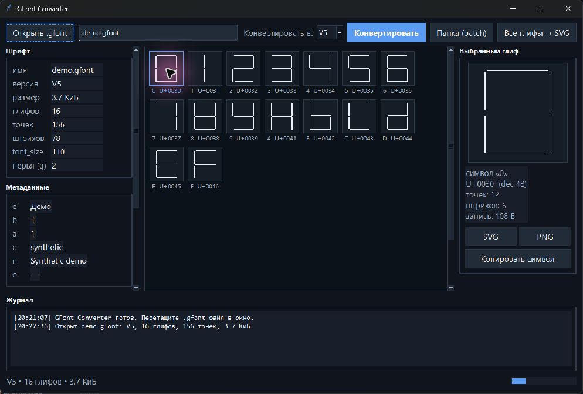

# GFont Converter

[](https://github.com/Ka1nnnn/gfont-converter/actions/workflows/ci.yml)
[](LICENSE)
[](https://github.com/Ka1nnnn/gfont-converter/releases/latest)

**GFont Converter** открывает, проверяет и преобразует векторные шрифты `.gfont` для KDraw / Kenjoy. В окне можно просмотреть глифы, найти символ, сохранить его в SVG или PNG, а также конвертировать один файл или целую папку.

## Скачать для Windows

**Готовая программа уже собрана. Python, командная строка и установка не нужны.**

### [Скачать GFont Converter для Windows](https://github.com/Ka1nnnn/gfont-converter/releases/latest)

1. Нажмите ссылку выше. Откроется страница последней версии программы.
2. Внизу страницы найдите **Assets** и нажмите **GFontConverter.exe**. Если список свёрнут, нажмите на стрелку рядом с **Assets**.
3. Дождитесь загрузки и откройте файл **GFontConverter.exe** из папки **Загрузки**. Отдельная установка не требуется: программу можно запускать прямо оттуда или перенести в удобную папку.
4. Если Windows покажет окно SmartScreen, сначала проверьте, что скачали файл именно со страницы релизов по ссылке выше. Приложение не подписано сертификатом Microsoft, поэтому Windows может предупредить о неизвестном издателе. Если вы доверяете скачанному файлу, нажмите **Подробнее → Выполнить в любом случае**.

## Как открыть и конвертировать шрифт

1. В окне программы нажмите **Открыть .gfont** и выберите файл шрифта. Исходный файл программа не изменяет.
2. Символы появятся в большой сетке. Нажмите на символ, чтобы увидеть его увеличенный вид и параметры.
3. Чтобы найти символ, введите его в поле поиска. Можно вводить сам знак, например `А`, или его код, например `U+0410`.
4. Для конвертации одного файла выберите **V3** или **V5** и нажмите **Конвертировать**. Рядом с исходным файлом появится новый файл с окончанием `_v3` или `_v5`.
5. Чтобы сохранить один символ как картинку или векторный рисунок, выберите его и нажмите **PNG** или **SVG**. Для сохранения всего шрифта в SVG выберите **Все глифы → SVG**.
6. Чтобы обработать сразу несколько шрифтов, нажмите **Папка (batch)** и выберите папку с файлами. Результаты появятся внутри неё в папке `converted_v3` или `converted_v5`.

Если файл не открылся, проверьте, что это именно `.gfont` и что он не повреждён. Поддерживаемые версии перечислены ниже.



## Возможности

- Чтение V0 (ZIP без заголовка), V3, V5, V6, V7, V8 и V9.
- Запись в V3 и V5; исходный файл остаётся нетронутым.
- Просмотр глифов, метаданных и предупреждений; масштабирование и поиск по символу или коду.
- Экспорт выбранного глифа в SVG/PNG и экспорт всего шрифта в SVG.
- Пакетная конвертация файлов из папки.
- Русский интерфейс, перетаскивание файлов и CLI для автоматизации.
- Python standard library во время работы; внешние зависимости для конвертации не нужны.

## Запуск из исходного кода

Этот раздел нужен только тем, кто хочет запускать программу из исходного кода. Обычному пользователю достаточно скачать готовый `.exe` по ссылке выше. Для запуска из исходного кода требуется Python 3.12 или новее с Tkinter:

```powershell
py -3.12 -m venv .venv
.\.venv\Scripts\Activate.ps1
python -m pip install .
python gfont_gui.py
```

Откроется окно программы.

## Как пользоваться

1. Нажмите **Открыть .gfont** или перетащите файл в окно.
2. Слева посмотрите версию, размер, число глифов и метаданные. Если программа показывает предупреждение, прочитайте его в журнале внизу.
3. Найдите символ: введите сам символ, десятичный код (`65`), шестнадцатеричный (`0x41`) или Unicode-код (`U+0410`).
4. Настройте размер клеток ползунком и выберите глиф в центральной сетке. Справа появится его увеличенный просмотр и параметры штрихов.
5. Нажмите **SVG** или **PNG**, чтобы сохранить выбранный глиф, либо **Копировать символ**, чтобы скопировать текстовый символ.
6. Для всего шрифта выберите **Все глифы → SVG**. Чтобы обработать папку, нажмите **Папка (batch)** и подтвердите целевой формат.
7. Для одного файла выберите V3 или V5 рядом с кнопкой **Конвертировать**. Результат сохраняется рядом с оригиналом с суффиксом `_v3` или `_v5`; оригинал не перезаписывается.

Пакетная конвертация складывает результат в отдельную папку `converted_v3` или `converted_v5` внутри выбранной папки.

## CLI

После `pip install .` доступна команда `gfont-converter`:

```powershell
# Конвертировать один файл в V5
gfont-converter font.gfont -o font_v5.gfont --target V5

# Конвертировать все .gfont из папки в V3
gfont-converter .\fonts --target V3
```

GUI-модуль поддерживает запуск без окна:

```powershell
# Проверить файл: чтение, экспорт PNG/SVG, roundtrip и поиск повреждений
python gfont_gui.py --smoke font.gfont

# Конвертировать без открытия окна
python gfont_gui.py --convert font.gfont -o font_v5.gfont --target V5
```

## Поддерживаемые версии

| Формат | Чтение | Запись | Примечание |
| --- | :---: | :---: | --- |
| V0 | Да | Нет | ZIP без заголовка и метаданных |
| V3 | Да | Да | Выходной формат поддерживает кодировки BMP |
| V5 | Да | Да | Основной целевой формат |
| V6 / V7 | Да | Нет | При конвертации можно сохранить как V3 или V5 |
| V8 | Да | Нет | Многоконтурные глифы |
| V9 | Да | Нет | Сырые KDraw-данные глифов |

Формат и ограничения разобраны подробнее в [справке по `.gfont`](docs/format.md).

## Важные ограничения

- V3 и V5 используют UTF-16/BMP для кодов глифов. Символы выше `U+FFFF` можно прочитать, но нельзя записать в эти два выходных формата.
- Команда Безье в старых глифах приближается отрезком.
- Несовпадение счётчика глифов в метаданных и числа записей ZIP показывается как предупреждение. Фактические записи ZIP считаются источником истины.
- Программа проверяет размеры контейнера, структуру ZIP и координаты глифов; повреждённые или слишком большие данные отклоняются.

## Разработка

```powershell
py -3.12 -m venv .venv
.\.venv\Scripts\Activate.ps1
python -m pip install -e ".[dev]"
python -m pytest
python -m ruff check .
pyinstaller GFontConverter.spec
```

Структура проекта:

```text
gfont_converter.py   разбор, проверка, конвертация и CLI
glyph_render.py      отрисовка глифов, SVG и PNG
gfont_gui.py         графический интерфейс и headless-команды
tests/               тесты и минимальные тестовые контейнеры
docs/                скриншот и справка по формату
```

## Лицензия и авторство

Проект распространяется по [MIT License](LICENSE). Эта версия основана на [claudessh/gfont-converter](https://github.com/claudessh/gfont-converter); исходная MIT-лицензия и сведения об авторстве сохранены.
